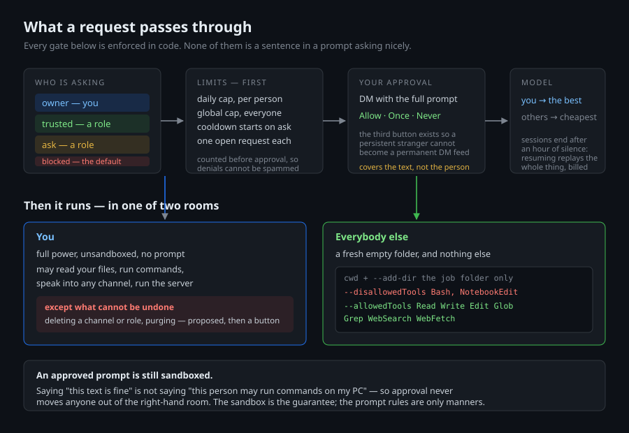

# Nova — a Discord bot that actually does things

Most Discord bots answer. This one **builds**: ask it for a presentation and a
file lands in the channel. Ask it to make a study channel and a role to go with
it, and the server changes. It runs on your own PC, on a Claude subscription
you already have — there is no API key anywhere in this project.

```
/promptnova make a short deck on the water cycle for a year 9 class
→ a finished .html presentation, attached
```

The interesting part is not that it can do that. It's what happens when
somebody who isn't you asks.

---

## The problem this solves

The moment a bot on your PC can write files and manage a server, every person
in your Discord is standing at a keyboard connected to your machine. Roles are
softer protection than they look: anyone with Manage Roles can grant themselves
one, a compromised account inherits whatever it had, and a prompt is a
persuasion surface by definition.

So the trust model is layered, and the layers are structural rather than
polite requests in a system prompt:

| Lane | Who | What happens |
|---|---|---|
| **owner** | you | runs immediately, unsandboxed, full power |
| **trusted** | a role you name | runs immediately, sandboxed |
| **ask** | a role you name | **you approve the prompt first**, then it runs sandboxed |
| **blocked** | everyone else | refused — this is the default |



### Sandboxed means sandboxed

Not "the prompt says please don't". Enforced by the CLI:

```
cwd + --add-dir   →  a fresh empty job folder, and nothing else
--disallowedTools    Bash, NotebookEdit
--allowedTools       Read, Write, Edit, Glob, Grep, WebSearch, WebFetch
```

A sandboxed request can research the web and author files — that's the whole
point of it. It cannot run a command, and it cannot see anything of yours,
because there is nothing else in the room with it. Approving somebody's prompt
says *"this text is fine"*, not *"this person may run commands on my PC"* — so
approved jobs stay sandboxed too.

### Nobody spends your tokens without you

Limits sit **in front of** the approval, not behind it. Otherwise the approval
DM is itself the spam vector: thirty-seven people hammering a command means
thirty-seven DMs even if you deny every one.

- a daily cap per person, and a global one across everybody
- a cooldown between one person's requests, which starts when they **ask**,
  not when you approve — so a stream of denials can't be used to spam you
- one unanswered request each, no queue-jumping
- **a denial costs them nothing** from their daily allowance
- you get the best model; everyone else gets the cheapest one

Counts persist to disk, so restarting the bot isn't a way around them.

### Conversation is invitation-only

The first time someone speaks to her, you get a DM with their message and three
buttons: **Allow** (from now on), **Just this once**, or **Never** (and stop
asking). Three rather than two on purpose — without the third, a persistent
stranger becomes a permanent stream of DMs, which is the same spam problem
wearing a different hat.

Change your mind any time with `/novachat user:@someone action:block`. Blocked
people are met with **silence**, not a refusal: a bot saying *"I can't talk to
you"* is still a bot talking, and still costs a call.

---

## What she can do

**Build things.** `/promptnova` runs a real job in a disposable folder and
attaches whatever it produces — documents, decks, spreadsheets, working HTML.
It's told to *build the file*, not describe one.

**Fetch things.** When you ask, she can find a file on your PC and post it.

**Speak into the server.** *"Send a message in general saying wazzaaa"* — she
does. Messages, files and embeds, into any channel you can reach. Owner only:
sandboxed runs are never even told the mechanism exists.

**Run the server.** Create channels and roles, rename, set topics, assign
roles, edit colours and permissions. `/novahub` turns any voice channel into a
join-to-create hub: each arrival gets their own room named after them and is
moved into it, and the room is binned when the last person leaves. Both the hub
list and the rooms it made are kept on disk — otherwise a restart forgets which
channel was the hub, and strands every room that was occupied at the time. On
reconnect she sweeps up the ones that emptied while she was down.

**Refuse to do the irreversible quietly.** Deleting a channel or role, or
purging messages, is *proposed* — you get a plain sentence and a button:

> **This cannot be undone.** Nova proposes:
> • delete the channel #dead
> • delete the last 200 messages in #spam

Discord has no undo, and *"tidy up general"* is not a clear enough instruction
to delete a year of conversation on. `administrator` is not on the grantable
permission list and never will be — it's every other permission at once,
handed out by a sentence somebody typed.

**Run a game.** `/novaplay game:a dungeon crawl under a drowned cathedral`
suspends the brevity rule and starts one. She tracks state and honours it —
health, inventory, who's dead, which door was locked and who has the key —
ends every turn with real options and waits, rolls honestly, and treats
multiple people in a channel as multiple players. `/novaplay` with nothing in
it ends the game.

It's a command rather than a mood she falls into because those rules are ~300
tokens, and paying them on every *"what time is it"* is 300 tokens for nothing.
They load when a game starts and not before.

**Keep herself alive.** `watch.ps1` restarts her if she dies, with exponential
backoff so a bad token doesn't spin the CPU. `install-task.ps1` registers it at
logon.

---

## Setup

```powershell
git clone https://github.com/<you>/nova-discord
cd nova-discord
pip install discord.py python-dotenv
npm install -g @anthropic-ai/claude-code   # then run `claude` once to sign in

Copy-Item .env.example .env                # fill it in
python list_roles.py                       # find your role IDs
.\install-task.ps1                         # start at logon, and stay up
```

**In the Developer Portal**, the bot needs the **Message Content** and **Server
Members** intents, and must be invited with the `bot` **and**
`applications.commands` scopes. Without the second, slash commands register
silently and never appear — nothing in the code can work around that.

### Commands

| | |
|---|---|
| `/promptnova` | ask her to build something |
| `/novachat` | decide who she may talk to |
| `/novaplay` | start a game here, or end it |
| `/novahub` | turn a voice channel into join-to-create |
| `/novasetup` | your tier, your model, your limits |
| `/getfile` | owner only: send a file or zipped folder from the PC (no tokens) |
| `/launch` | owner only: open an app or shortcut on the PC (no tokens) |
| `/purge` | owner only: delete messages here by person, from/to a message, or by text |
| right-click a message → Apps | owner only: *Purge from here down*, *Purge their messages here* |
| `!ping` `!whereami` | is she alive, and where |

---

## Cost

Chat is roughly 1–2k tokens a message. A job that researches a topic and builds
a file is realistically 20k–80k, because it's running searches and writing
files. That gap is why the two run on different models by default, and why the
caps exist.

Conversations are finished after an hour of silence. Resuming an old session
replays the whole thing back into the model every time — an old session isn't
free continuity, it's a bill that grows.

---

## What never leaves your machine

Your token, your logs, your conversations, the job folders. `.gitignore`
excludes all of it. She's also instructed never to reveal the account she runs
under, file paths, what she's built from, or what tools she has — if asked what
she is, the entire answer is *"I am Nova. I am <your name>'s assistant."*

That last part is a prompt-level defence, and prompts are persuadable. The
structural one is the sandbox: for anyone but you, the process cannot see your
files, because its working directory is empty and `Bash` is disallowed.

Released under the [MIT Licence](LICENSE).
